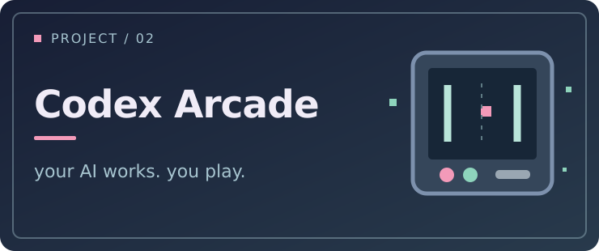
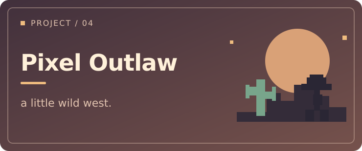

  

### Hey, I'm Lindreams 👋

天津大学软件工程在读。

喜欢把脑子里冒出来的点子做成真正能用的东西。  
虽然经常做着做着就停不下来了。

### 🧩 做过的一些东西

<table>
  <tr>
    <td width="50%" valign="top">
      
       
      <strong><a href="https://github.com/lindreams/echo-chat-analyzer">余音 Echo</a></strong>
       
      把 QQ / 微信聊天整理成可以慢慢回看的报告。
    </td>
    <td width="50%" valign="top">
      
       
      <strong><a href="https://github.com/lindreams/codex-arcade">Codex Arcade</a></strong>
       
      等 Codex 工作时玩点小游戏。
    </td>
  </tr>
  <tr>
    <td width="50%" valign="top">
      
       
      <strong><a href="https://github.com/lindreams/spire-qq-bot">Spire QQ Bot</a></strong>
       
      查卡牌、遗物、事件，还能和群友一起猜卡。
    </td>
    <td width="50%" valign="top">
      
       
      <strong><a href="https://github.com/lindreams/pixel-outlaw">Pixel Outlaw</a></strong>
       
      一个可以<a href="https://lindreams.github.io/pixel-outlaw/">在线试玩</a>的西部像素射击小游戏。
    </td>
  </tr>
</table>

  
👀 看看它们长什么样

   
  
   
  Echo Report · 虚构演示数据
    
  
   
  Codex Arcade · 在等待 Codex 工作时玩

---

Dreams in the name, TODOs in the code. 🌙
