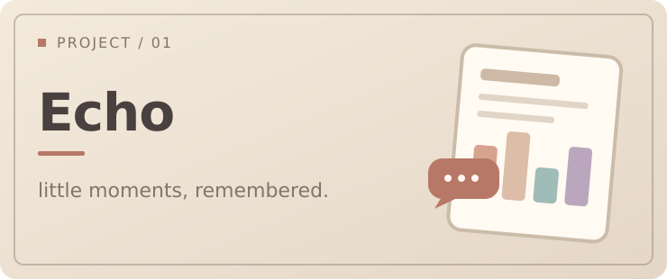
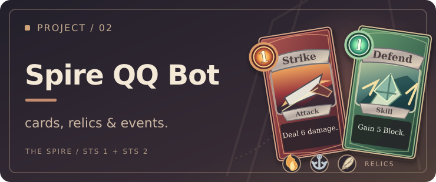

  

### Hey, I'm Lindreams 👋

天津大学软件工程在读。

喜欢把脑子里冒出来的点子做成真正能用的东西。  
虽然经常做着做着就停不下来了。

### 🛠️ Projects

<table>
  <tr>
    <td width="55%" valign="top">
      
       
      <strong><a href="https://github.com/lindreams/echo-chat-analyzer">余音 Echo</a></strong>
       
      主线任务 · 持续开发中
        
      把 QQ / 微信聊天整理成可以慢慢回看的报告。第一个认真尝试做成完整软件的项目，还在慢慢完善。
    </td>
    <td width="45%" valign="top">
      
       
      <strong><a href="https://github.com/lindreams/spire-qq-bot">Spire QQ Bot</a></strong>
       
      完成度比较高的兴趣项目
        
      给《杀戮尖塔》做的 QQ 机器人。能查卡牌、遗物和事件，也能和群友一起猜卡、玩随机事件。
    </td>
  </tr>
</table>

  
👀 看看 Echo 的报告

   
  
   
  Echo Report · 虚构演示数据

### 🎮 Side Quests

- **[Codex Arcade](https://github.com/lindreams/codex-arcade)** — 一个晚上做出来的 Codex 小插件。等 AI 工作的时候，顺手玩两把小游戏。
- **[Pixel Outlaw](https://github.com/lindreams/pixel-outlaw)** — 没做完的西部像素射击小游戏，基本是 AI 搭起来的。后来跑去做 Echo，就先搁置了。

---

Dreams in the name, TODOs in the code. 🌙
